


&nbsp;&nbsp;

 



<a href="https://github.com/Javiervalenciam/AppIndemnizaciones"></a>

  
  
  

<b>Pensiones y legal-tech</b> · 12 repositorios

 

| Proyecto | Qué hace | Stack | Acceso |
| :-- | :-- | :-- | :-- |
| **CETILIA** | Evaluación trazable de historias laborales y decisiones pensionales | Python · FastAPI · React | 🔒 Privado |
| **AppPensional** | Estudios pensionales: semanas cotizadas, IBL, mesada e informes en Excel | Python · Streamlit | 🔒 Privado |
| **AppHistorias360** | Auditoría de PDFs de historia laboral de Colpensiones, Porvenir y Protección | Python · TypeScript | 🔒 Privado |
| **AppAFP** | Tiempos cotizados en fondos privados, inconsistencias y favorabilidad RAIS / RPM | JavaScript · Python · SQLite | 🔒 Privado |
| [**AppIndemnizaciones**](https://github.com/Javiervalenciam/AppIndemnizaciones) | Liquidación de indemnización sustitutiva de vejez con IPC y certificados CETIL | Python · Dash · pandas | Público |
| **DEFLACION** | Deflactor pensional con el IPC del DANE, determinístico y 100 % local | Python | 🔒 Privado |
| **pensiotech** | Sitio profesional de servicios pensionales · [pensiotech.bond](https://www.pensiotech.bond/) | TypeScript | 🔒 Privado |
| **dashboard-vercel** | Dashboard de datos pensionales, excedentes y pasivos de Norte de Santander · [demo](https://dashboard-vercel-three-liart.vercel.app) | HTML · JavaScript | 🔒 Privado |
| [**lex-pension**](https://github.com/Javiervalenciam/lex-pension) | Sitio web para oficina jurídica y pensional | HTML · CSS · JavaScript | Público |
| [**Pension-Desk**](https://github.com/Javiervalenciam/Pension-Desk) | Gestor de documentos para asesoría pensional | TypeScript | Público |
| [**PensionDesk-Animated**](https://github.com/Javiervalenciam/PensionDesk-Animated) | MVP escalable de Pension Desk con recursos animados | TypeScript · Python | Público |
| [**analizador-pension**](https://github.com/Javiervalenciam/analizador-pension) | Fork: análisis de aportes a Colpensiones y proyección pensional | TypeScript | Público |

<b>Datos, finanzas y modelos</b> · 4 repositorios

 

| Proyecto | Qué hace | Stack | Acceso |
| :-- | :-- | :-- | :-- |
| **MUNDIAL** | WC26 Intelligence: seguimiento y predicción del Mundial 2026 con Elo, Poisson y Monte Carlo | TypeScript · FastAPI · PostgreSQL | 🔒 Privado |
| **MERCADO** | Presupuesto y control del mercado del hogar · [demo](https://mercado-davinccy.vercel.app) | TypeScript · PostgreSQL | 🔒 Privado |
| **FINANZAS** | Registro de ingresos y finanzas personales · [demo](https://finanzas-lilac.vercel.app) | TypeScript · PostgreSQL | 🔒 Privado |
| **Finanzas_Personales** | Página para registro de finanzas personales | — | 🔒 Privado |

<b>Herramientas de escritorio, IA y productividad</b> · 6 repositorios

 

| Proyecto | Qué hace | Stack | Acceso |
| :-- | :-- | :-- | :-- |
| **PDFlow** | Herramientas PDF 100 % locales y portables para Windows | TypeScript · React | 🔒 Privado |
| **EXTRACTA** | Lector editorial multiformato (EPUB, MOBI, PDF) para Windows, sin conexión | Electron · JavaScript | 🔒 Privado |
| **Explorar** | Explorador de archivos con índice de texto completo y vista previa | Python · Tkinter · SQLite | 🔒 Privado |
| **AiDev** | AI Dev Console: panel local y cifrado para gestionar asistentes de código | Node.js | 🔒 Privado |
| **GestorPromptsV5** | Gestor personal de prompts, quinta versión | JavaScript | 🔒 Privado |
| [**MyGestorPrompts**](https://github.com/Javiervalenciam/MyGestorPrompts) | Herramienta local para crear prompts | HTML | Público |

<b>Negocios y comercio</b> · 5 repositorios

 

| Proyecto | Qué hace | Stack | Acceso |
| :-- | :-- | :-- | :-- |
| **jackychina** | Tienda web de comida china con pedidos · [jackychina.app](https://jackychina.app) | TypeScript | 🔒 Privado |
| **Restaurante-llanero** | Menú y pedidos para restaurante llanero · [demo](https://llano-restaurante-davinccy.vercel.app) | Next.js · TypeScript | 🔒 Privado |
| [**dulce-cupones**](https://github.com/Javiervalenciam/dulce-cupones) | Cupones QR promocionales para repostería · [demo](https://dulce-cupones.vercel.app) | JavaScript | Público |
| [**SistemaPOS-Heladeria**](https://github.com/Javiervalenciam/SistemaPOS-Heladeria) | Facturación e inventario para una heladería | JavaScript | Público |
| **Bruma-Maquillaje** | Sitio web para marca de maquillaje | HTML | 🔒 Privado |

<b>Ambiente y perfil</b> · 3 repositorios

 

| Proyecto | Qué hace | Stack | Acceso |
| :-- | :-- | :-- | :-- |
| **PortafolioAmbiental** | Portafolio profesional para ingeniería ambiental | — | 🔒 Privado |
| [**sitio-consultoria-ambiental**](https://github.com/Javiervalenciam/sitio-consultoria-ambiental) | Sitio de consultoría ambiental y proyectos del territorio | — | Público |
| [**Javiervalenciam**](https://github.com/Javiervalenciam/Javiervalenciam) | Este perfil: SVG animados y estadísticas generadas con la API de GitHub | Python · SVG | Público |

 


&nbsp;&nbsp;&nbsp;&nbsp;

  

Los proyectos privados se describen solo a nivel general, sin exponer código ni datos sensibles. Las estadísticas incluyen repositorios privados y se regeneran a diario.

---

## Autor

<table>
  <tr>
    <td width="120" align="center" valign="middle">
      
    </td>
    <td valign="middle">
      <strong>Javier Valencia</strong> 
      Administrador Ambiental y Data Analyst · Colombia 
      Diseño, desarrollo y operación de JavIPTV.
    </td>
  </tr>
</table>

